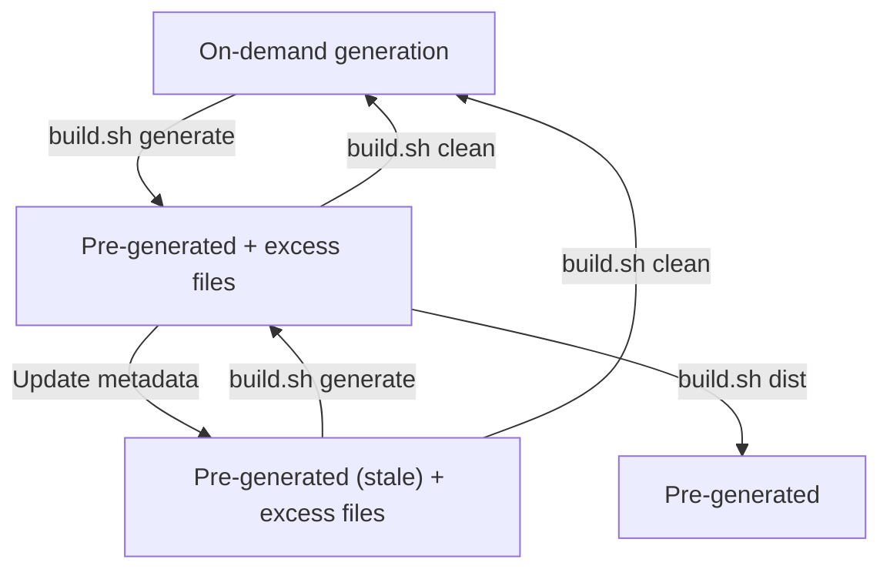

# Developing OmniKit

This guide is for developers who work on OmniKit itself.


-----------------------------------------------------------------------------------------


## Prerequisite

The following software is required to develop OmniKit:

- [MSYS2][3] with [ucrt64 environment][4] (Windows only)
     - Make sure `/ucrt64/bin` is included in `$PATH`.

- GLib <!-- [tag:doc_prerequisite_glib] -->
     - On Windows, this must be installed by MSYS2 package `mingw-w64-ucrt-x86_64-glib`

 - `pkg-config` <!-- [tag:doc_prerequisite_pkg_config] -->
     - On Windows, this must be installed by MSYS2 package `mingw-w64-ucrt-x86_64-pkgconf`

- [Rustup][1]
     - On Windows, rustup must be [configured][7] to use the GNU toolchain by default.

- [gtk-rs's gir tool][2], which is included in this repository as the submodule `../../vendor/gtk-rs-gir`
  <!-- [dir:../vendor/gtk-rs-gir] -->
  <!-- [tag:api_build_prerequisite_gir] -->

- `nixfmt` <!-- [tag:doc_prerequisite_nixfmt] -->
    - This is optional. If installed, `tidy.sh` <!-- [file:../etc/tidy.sh] --> uses it to check formatting of `.nix` files

- `actionlint` <!-- [tag:doc_prerequisite_actionlint] -->
    - This is optional. If installed, `tidy.sh` <!-- [file:../etc/tidy.sh] --> uses it to validate GitHub Actions workflows

- `gi-docgen` <!-- [tag:doc_prerequisite_gi_docgen] -->
    - On Windows, install with the MSYS2 package `mingw-w64-ucrt-x86_64-gi-docgen`

- GIR metadata for dependencies <!-- [tag:doc_prerequisite_gir] -->
    - On Windows, install with the MSYS2 package `mingw-w64-ucrt-x86_64-glib2`
    - On Debian, this is provided by [`libgirepository1.0-dev`][6]

When using [the Nix package manager][5], all prerequisites can be made available by running `nix develop`.


-----------------------------------------------------------------------------------------


## Pre-Commit Checklist

- Make sure that all relevant tests (e.g., `cargo test` in `../rust`) pass

- Make sure that `../etc/tidy.sh` reports no errors
    - Since this command is pretty fast, it is recommended to run it automatically from a git pre-commit hook.

> Maintaining a test-pass state ensures that bisection does not land on a known-broken state.
> Maintaining formatting avoids accidental inclusion of irrelevant formatting changes in future commits (some text editors auto-format by default).


-----------------------------------------------------------------------------------------


## Code generation

Some language bindings require code to be generated from API metadata before they can be used for plugin development.
The code generation process requires specialized tools that are not readily available on a user’s system.
Therefore, to facilitate its use, we perform this step before distribution (this is called *pre-generation*).

### On-demand generation state

`[tag:codegen_ondemand_state]`
A copy of OmniKit is said to be in an *on-demand generation state* when it does not bundle the pre-generated output.
Some (but not all) binding libraries can work in this state by generating binding code at build time.
**The canonical source tree for OmniKit is stored in the on-demand generation state.**

### Pre-generated state

`[tag:codegen_pregen_state]`
A copy of OmniKit is said to be in a *pre-generated state* when it bundles the pre-generated output.
All binding libraries work correctly in this state.
**This is the form delivered to plugin developers.**

> [!NOTE]
> This system needs to be extended to support languages and ecosystems where libraries are normally distributed in a binary form, such as .NET.

### Pre-generation scripts

`[tag:codegen_build_sh]`
Each language binding provides `build.sh`, a shell script implementing the pre-generation step.
It provides three standardized commands:

- `build.sh generate` generates binding code while leaving excess files in place.

- `build.sh clean` removes generated binding code, returning to the on-demand generation state.

- `build.sh dist` copies only the files necessary in the pre-generated state to `$OMNIKIT_DIST` and prepares the code for distribution.




-----------------------------------------------------------------------------------------


## Maintenance

### Tagref

`[tag:tagref]`
This project uses a tool called [Tagref](https://crates.io/crates/tagref) to maintain cross-references across source files. Example:

```rust
/// `FOO` is an odd number <!-- [tag:foo_odd] -->
// (In doc comments, wrap the tags in `...` or <!-- ... --> to prevent them
// from being parsed as a Markdown link)
const FOO: i32 = 51;

// This assertion is valid because of [ref:foo_odd]
assert_eq!(FOO % 2, 1);
```


### Updating API metadata

After updating the plugin API, it must be manually synchronized to this repository.
Perform the following steps:

1. Run `cargo xtask kit` in the Omnisight source tree (private).

2. Copy the generated `target/omnikit/{Omni-0.0.gir,omnikit.h}` into this repository's `meta/` directory.

> TODO: Define the process to push this change to the repository.


[1]: https://rust-lang.github.io/rustup/index.html
[2]: https://github.com/gtk-rs/gir
[3]: https://www.msys2.org/
[4]: https://www.msys2.org/docs/environments/
[5]: https://nix.dev/
[6]: https://packages.debian.org/trixie/libgirepository1.0-dev
[7]: https://rust-lang.github.io/rustup/installation/windows.html
